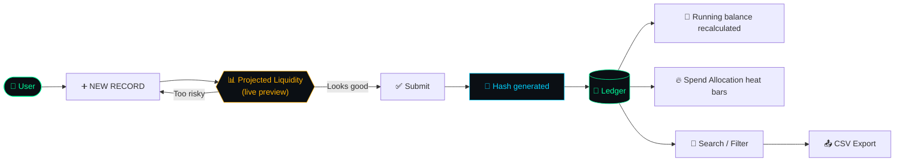
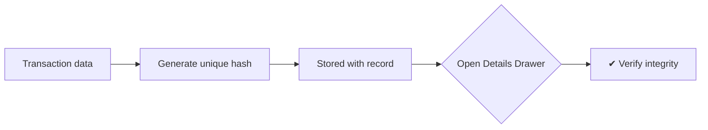
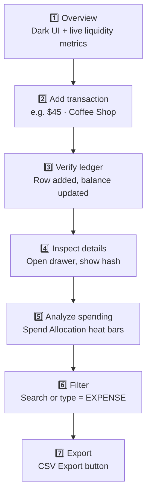
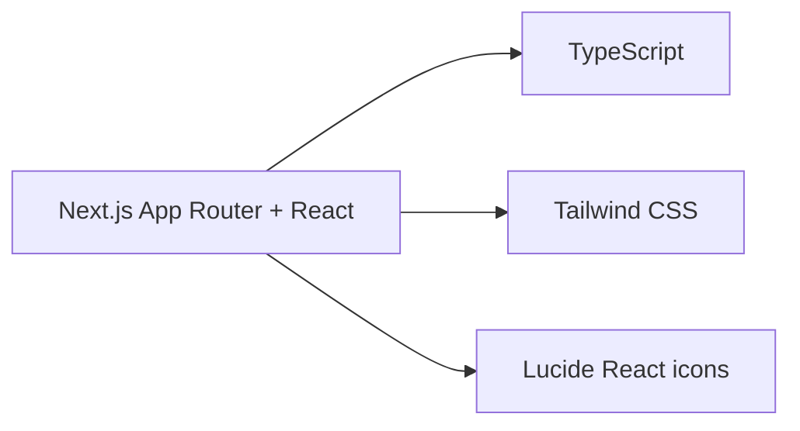

<div align="center">

# 📟 Personal Expense Tracker

### A Bloomberg-terminal-style dashboard for your money.
**High density. Zero fluff. Every rupee, dollar and cent in one view.**


[**Quick Start**](#-quick-start) · [**How It Works**](#-how-it-works) · [**Features**](#-features) · [**Demo Script**](#-demo-script) · [**Tech Stack**](#%EF%B8%8F-tech-stack)

<!-- 📸 Add a screenshot or GIF here:

-->

</div>

---

## 🎯 Why This Exists

Most expense trackers waste screen space on padding and pastel cards. **This one doesn't.**
It's built for people who want cash flow, liquidity and spending allocation in **one unified, trade-desk interface**.

---

## ⚡ How It Works

> 👇 The whole app in one flow.



### 🔐 Audit Trail in 3 Steps



---

## ✨ Features

| | Feature | What you get |
|---|---|---|
| 🖥️ | **Trade-Desk UI** | Dark theme, monospace type, neon accents |
| 📒 | **Transaction Ledger** | Every entry with a dynamic running balance |
| 🔮 | **Record Modal** | See *projected liquidity* before you commit |
| 🔥 | **Spend Allocation** | Interactive heat bars + category breakdown |
| 🔎 | **Filter & Search** | By text, type (e.g. `EXPENSE`) or category |
| 📤 | **CSV Export** | One click, straight to your analysis tools |
| 🔐 | **Audit Trail** | Unique cryptographic hash per transaction |

---

## 🚀 Quick Start

**Requires:** Node.js 18+ and npm / yarn / pnpm

```bash
git clone https://github.com/YuvrajsinghAIML/Personal-Expense-Tracker.git
cd Personal-Expense-Tracker
npm install
npm run dev
```

Open 👉 **http://localhost:3000**

---

## 🎬 Demo Script

<details>
<summary><b>▶ Click to expand the 7-step walkthrough</b></summary>

<br/>



| Step | Action | Point to highlight |
|---|---|---|
| 1 | Show the dashboard | Terminal aesthetic, high data density |
| 2 | Click **+ NEW RECORD**, enter `$45 – Coffee Shop` | *Projected Liquidity* updates **before** submit |
| 3 | Submit, check the ledger | New row + auto-recalculated running balance |
| 4 | Click any row | Cryptographic hash in the details drawer |
| 5 | Look at Spend Allocation | Category heat bars |
| 6 | Use search / type filter | Instant narrowing, e.g. `EXPENSE` |
| 7 | Click **CSV Export** | Data out in one click |

</details>

---

## 🛠️ Tech Stack



| Layer | Tool |
|---|---|
| Framework | Next.js (App Router), React |
| Language | TypeScript |
| Styling | Tailwind CSS |
| Icons | Lucide React |

---

## 🤝 Contributing

<details>
<summary><b>Want to help?</b></summary>

1. Fork the repo
2. Create a branch: `git checkout -b feature/my-feature`
3. Commit: `git commit -m "Add my feature"`
4. Push: `git push origin feature/my-feature`
5. Open a Pull Request

</details>

---

<div align="center">

**Built by [SamSurve](https://github.com/SamSurve) & [Yuvraj Singh](https://github.com/YuvrajsinghAIML)**

⭐ If this project helped you, drop a star!

</div>
